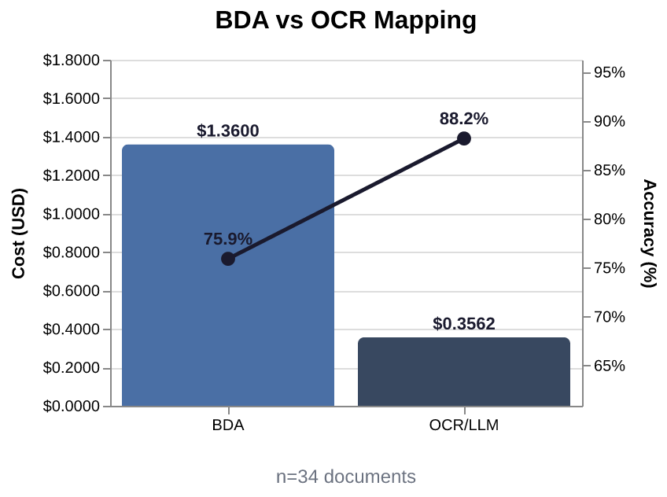

# DocumentAI - Extraction Comparison

_Last run: 2026-10-28 20:04 UTC - 35 documents_

## Cost by Model and Service
_Excludes the primary-path fee (BDA or Textract AnalyzeID); see the tables below._

- textract - AnalyzeDocument (layout): $0.140000
- us.amazon.nova-lite-v1:0: $0.002790
- us.amazon.nova-pro-v1:0: $0.541558
- **subtotal: $0.684348**

## Extraction Comparison

### BDA vs. Textract OCR / LLM Mapping
<table style="width:100%"><tr>
<td style="text-align:center;"></td>
</tr>
<tr>
<td><table><tr><th>Metric</th><th>BDA</th><th>OCR / LLM</th><th>Delta</th></tr><tr><td>Speed (median)</td><td>25.00s</td><td>3.29s</td><td style="color:#16a34a">7.6x faster</td></tr><tr><td>Cost</td><td>$1.3600</td><td>$0.3562</td><td style="color:#16a34a">3.8x cheaper</td></tr><tr><td>Accuracy (Equiv.)</td><td>359/485 (74%)</td><td>411/485 (85%)</td><td style="color:#16a34a">+11 pts</td></tr><tr><td>Accuracy (Equiv+Approx.)</td><td>368/485 (76%)</td><td>428/485 (88%)</td><td style="color:#16a34a">+12 pts</td></tr><tr><td>Bounding Box</td><td>165/302 (55%)</td><td>171/302 (57%)</td><td style="color:#16a34a">+2 pts</td></tr></table></td>
</tr></table>

### Textract Identity vs. Textract OCR / LLM Mapping
<table style="width:100%"><tr>
<td style="text-align:center;"></td>
</tr>
<tr>
<td><table><tr><th>Metric</th><th>Textract</th><th>OCR / LLM</th><th>Delta</th></tr><tr><td>Speed (median)</td><td>1.41s</td><td>2.77s</td><td style="color:#dc2626">2.0x slower</td></tr><tr><td>Cost</td><td>$0.0250</td><td>$0.0106</td><td style="color:#16a34a">2.4x cheaper</td></tr><tr><td>Accuracy (Equiv.)</td><td>12/13 (92%)</td><td>13/13 (100%)</td><td style="color:#16a34a">+8 pts</td></tr><tr><td>Accuracy (Equiv+Approx.)</td><td>13/13 (100%)</td><td>13/13 (100%)</td><td style="color:#16a34a">+0 pts</td></tr><tr><td>Bounding Box</td><td>7/10 (70%)</td><td>7/10 (70%)</td><td style="color:#16a34a">+0 pts</td></tr></table></td>
</tr></table>

## Document Summary

| Document | Primary Method | Total Cost | Primary Cost | OCR/LLM Cost | Cost Delta | Primary Duration | OCR/LLM Duration | Duration Delta | Primary Match Rate (Equiv+Approx.) | OCR/LLM Match Rate (Equiv+Approx.) | Match Rate Delta |
|---|---|---|---|---|---|---|---|---|---|---|---|
| [synthetic-assets-bank-statement-render-spanish](md/synthetic-assets-bank-statement-render-spanish.md) | bda | $0.061682 | $0.049295 | $0.021682 | -0.027613 | 24.83s | 10.73s | -14.10s | 7/15 (47%) | 14/15 (93%) | +46.7% |
| [synthetic-assets-bank-statement-render](md/synthetic-assets-bank-statement-render.md) | bda | $0.057774 | $0.048760 | $0.017774 | -0.030986 | 24.31s | 2.68s | -21.63s | 6/8 (75%) | 8/8 (100%) | +25.0% |
| [synthetic-assets-bank-statement-scan](md/synthetic-assets-bank-statement-scan.md) | bda | $0.059977 | $0.049256 | $0.019977 | -0.029279 | 22.29s | 7.70s | -14.59s | 8/15 (53%) | 10/15 (67%) | +13.3% |
| [synthetic-assets-life-insurance-policy-render](md/synthetic-assets-life-insurance-policy-render.md) | bda | $0.056513 | $0.048814 | $0.016513 | -0.032302 | 23.84s | 1.75s | -22.09s | 10/10 (100%) | 10/10 (100%) | 0% |
| [synthetic-assets-life-insurance-policy-scan](md/synthetic-assets-life-insurance-policy-scan.md) | bda | $0.057336 | $0.049288 | $0.017336 | -0.031953 | 22.22s | 5.96s | -16.26s | 10/10 (100%) | 10/10 (100%) | 0% |
| [synthetic-assets-trust-funds-investment-accounts-render-spanish](md/synthetic-assets-trust-funds-investment-accounts-render-spanish.md) | bda | $0.057999 | $0.049266 | $0.017999 | -0.031267 | 25.10s | 3.22s | -21.88s | 9/10 (90%) | 9/10 (90%) | 0% |
| [synthetic-assets-trust-funds-investment-accounts-render](md/synthetic-assets-trust-funds-investment-accounts-render.md) | bda | $0.056923 | $0.048840 | $0.016923 | -0.031917 | 21.62s | 6.72s | -14.90s | 7/10 (70%) | 9/10 (90%) | +20.0% |
| [synthetic-assets-trust-funds-investment-accounts-scan](md/synthetic-assets-trust-funds-investment-accounts-scan.md) | bda | $0.057871 | $0.049285 | $0.017871 | -0.031414 | 24.06s | 2.64s | -21.42s | 9/10 (90%) | 10/10 (100%) | +10.0% |
| [synthetic-expense-child-support-rendered](md/synthetic-expense-child-support-rendered.md) | bda | $0.057562 | $0.048776 | $0.017562 | -0.031214 | 44.04s | 2.95s | -41.09s | 6/6 (100%) | 5/6 (83%) | -16.7% |
| [synthetic-expense-child-support-scan](md/synthetic-expense-child-support-scan.md) | bda | $0.059585 | $0.049269 | $0.019585 | -0.029685 | 44.16s | 3.37s | -40.79s | 14/14 (100%) | 14/14 (100%) | 0% |
| [synthetic-expense-dependent-care-render](md/synthetic-expense-dependent-care-render.md) | bda | $0.057006 | $0.048818 | $0.017006 | -0.031812 | 22.09s | 2.02s | -20.07s | 9/11 (82%) | 11/11 (100%) | +18.2% |
| [synthetic-expense-dependent-care-scan](md/synthetic-expense-dependent-care-scan.md) | bda | $0.058149 | $0.049292 | $0.018149 | -0.031142 | 42.77s | 3.17s | -39.60s | 9/11 (82%) | 11/11 (100%) | +18.2% |
| [synthetic-expense-utility-cable-bill-render-spanish](md/synthetic-expense-utility-cable-bill-render-spanish.md) | bda | $0.059897 | $0.049273 | $0.019897 | -0.029375 | 24.38s | 6.44s | -17.94s | 7/10 (70%) | 10/10 (100%) | +30.0% |
| [synthetic-expense-utility-cable-bill-render](md/synthetic-expense-utility-cable-bill-render.md) | bda | $0.058132 | $0.048824 | $0.018132 | -0.030692 | 24.04s | 4.29s | -19.75s | 7/10 (70%) | 10/10 (100%) | +30.0% |
| [synthetic-expense-utility-electric-bill-render-spanish](md/synthetic-expense-utility-electric-bill-render-spanish.md) | bda | $0.063921 | $0.049282 | $0.023921 | -0.025362 | 27.06s | 10.15s | -16.91s | 11/25 (44%) | 17/25 (68%) | +24.0% |
| [synthetic-expense-utility-electric-bill-render](md/synthetic-expense-utility-electric-bill-render.md) | bda | $0.062744 | $0.048779 | $0.022744 | -0.026035 | 34.62s | 11.12s | -23.50s | 12/24 (50%) | 22/24 (92%) | +41.7% |
| [synthetic-expense-utility-electric-bill-scan](md/synthetic-expense-utility-electric-bill-scan.md) | bda | $0.063700 | $0.049266 | $0.023700 | -0.025566 | 22.89s | 9.72s | -13.17s | 12/25 (48%) | 23/25 (92%) | +44.0% |
| [synthetic-expense-utility-water-sewer-bill-render-spanish](md/synthetic-expense-utility-water-sewer-bill-render-spanish.md) | bda | $0.062267 | $0.049276 | $0.022267 | -0.027010 | 27.24s | 6.71s | -20.53s | 17/21 (81%) | 20/21 (95%) | +14.3% |
| [synthetic-expense-utility-water-sewer-bill-render](md/synthetic-expense-utility-water-sewer-bill-render.md) | bda | $0.060826 | $0.048814 | $0.020826 | -0.027989 | 27.63s | 4.28s | -23.35s | 16/19 (84%) | 18/19 (95%) | +10.5% |
| [synthetic-expense-utility-water-sewer-bill-scan](md/synthetic-expense-utility-water-sewer-bill-scan.md) | bda | $0.061864 | $0.049298 | $0.021864 | -0.027434 | 26.11s | 5.21s | -20.90s | 19/21 (90%) | 20/21 (95%) | +4.8% |
| [synthetic-insurance-health-insurance-premium-render-spanish](md/synthetic-insurance-health-insurance-premium-render-spanish.md) | bda | $0.058332 | $0.049292 | $0.018332 | -0.030960 | 28.55s | 2.82s | -25.73s | 11/11 (100%) | 9/11 (82%) | -18.2% |
| [synthetic-insurance-health-insurance-premium-render](md/synthetic-insurance-health-insurance-premium-render.md) | bda | $0.057437 | $0.048779 | $0.017437 | -0.031342 | 25.54s | 2.76s | -22.78s | 11/11 (100%) | 11/11 (100%) | 0% |
| [synthetic-insurance-health-insurance-premium-scan](md/synthetic-insurance-health-insurance-premium-scan.md) | bda | $0.058257 | $0.049272 | $0.018257 | -0.031015 | 31.97s | 2.45s | -29.52s | 11/11 (100%) | 11/11 (100%) | 0% |
| [synthetic-investment-and-royalty-income-render-spanish](md/synthetic-investment-and-royalty-income-render-spanish.md) | bda | $0.057195 | $0.049324 | $0.017195 | -0.032129 | 28.16s | 2.84s | -25.32s | 8/12 (67%) | 7/12 (58%) | -8.3% |
| [synthetic-investment-and-royalty-income-render](md/synthetic-investment-and-royalty-income-render.md) | bda | $0.056250 | $0.048766 | $0.016250 | -0.032517 | 25.73s | 2.20s | -23.53s | 6/6 (100%) | 6/6 (100%) | 0% |
| [synthetic-investment-and-royalty-income-scan](md/synthetic-investment-and-royalty-income-scan.md) | bda | $0.057172 | $0.049295 | $0.017172 | -0.032123 | 26.04s | 1.88s | -24.16s | 8/12 (67%) | 8/12 (67%) | 0% |
| [synthetic-public-benefits-identity-proof-state-photo-id](md/synthetic-public-benefits-identity-proof-state-photo-id.md) | textract | $0.044474 | $0.033874 | $0.019474 | -0.014400 | 1.41s | 2.77s | +1.36s | 13/13 (100%) | 13/13 (100%) | 0% |
| [synthetic-public-benefits-income-proof-pay-statement-photo](md/synthetic-public-benefits-income-proof-pay-statement-photo.md) | bda | $0.067742 | $0.048992 | $0.027742 | -0.021250 | 25.40s | 18.92s | -6.48s | 29/35 (83%) | 32/35 (91%) | +8.6% |
| [synthetic-public-benefits-income-proof-pay-statement-rendered](md/synthetic-public-benefits-income-proof-pay-statement-rendered.md) | bda | $0.067644 | $0.048896 | $0.027644 | -0.021251 | 24.89s | 13.73s | -11.16s | 29/35 (83%) | 32/35 (91%) | +8.6% |
| [synthetic-public-benefits-income-proof-pay-stub](md/synthetic-public-benefits-income-proof-pay-stub.md) | bda | $0.067602 | $0.048964 | $0.027602 | -0.021362 | 24.58s | 22.93s | -1.65s | 23/29 (79%) | 25/29 (86%) | +6.9% |
| [synthetic-shelter-shelter-verification-render-spanish](md/synthetic-shelter-shelter-verification-render-spanish.md) | bda | $0.059163 | $0.049285 | $0.019163 | -0.030122 | 23.97s | 4.65s | -19.32s | 7/7 (100%) | 0/7 (0%) | -100.0% |
| [synthetic-shelter-shelter-verification-render](md/synthetic-shelter-shelter-verification-render.md) | bda | $0.056115 | $0.048818 | $0.016115 | -0.032702 | 27.35s | 2.34s | -25.01s | 7/7 (100%) | 6/7 (86%) | -14.3% |
| [synthetic-shelter-shelter-verification-scan](md/synthetic-shelter-shelter-verification-scan.md) | bda | $0.058393 | $0.049285 | $0.018393 | -0.030892 | 22.76s | 2.91s | -19.85s | 0/10 (0%) | 8/10 (80%) | +80.0% |
| [synthetic-snap-income-proof-employment-wage-verification-letter-photo](md/synthetic-snap-income-proof-employment-wage-verification-letter-photo.md) | bda | $0.055966 | $0.049024 | $0.015966 | -0.033058 | 23.43s | 1.68s | -21.75s | 7/7 (100%) | 6/7 (86%) | -14.3% |
| [synthetic-snap-income-proof-employment-wage-verification-letter-rendered](md/synthetic-snap-income-proof-employment-wage-verification-letter-rendered.md) | bda | $0.055879 | $0.048950 | $0.015879 | -0.033071 | 21.34s | 1.78s | -19.56s | 6/7 (86%) | 6/7 (86%) | 0% |

