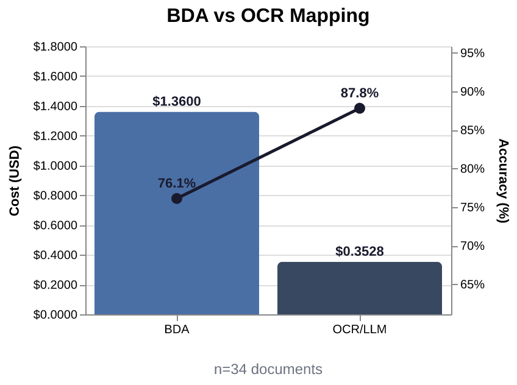
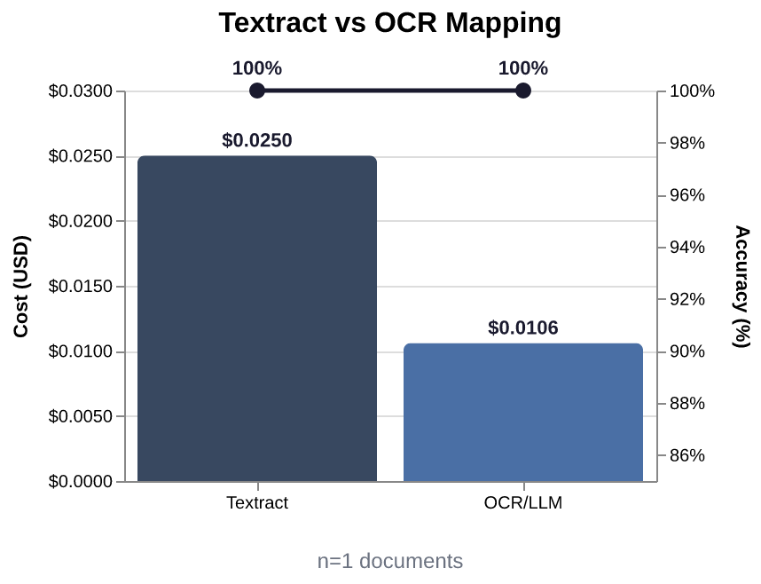

# DocumentAI - Extraction Comparison

_Last run:: 2026-10-29 21:23 UTC - 35 documents_

## Cost by Model and Service

_Excludes the primary-path fee (BDA or Textract AnalyzeID); see the tables below._

- textract - AnalyzeDocument (layout): $0.140000
- us.amazon.nova-lite-v1:0: $0.002790
- us.amazon.nova-pro-v1:0: $0.538432
- **subtotal: $0.681222**

## Extraction Comparison

### BDA vs. Textract OCR / LLM Mapping

<table style="width:100%"><tr>
<td style="text-align:center;"></td>
</tr>
<tr>
<td><table><tr><th>Metric</th><th>BDA</th><th>OCR / LLM</th><th>Delta</th></tr><tr><td>Speed (median)</td><td>25.23s</td><td>3.65s</td><td style="color:#16a34a">6.9x faster</td></tr><tr><td>Cost</td><td>$1.3600</td><td>$0.3528</td><td style="color:#16a34a">3.9x cheaper</td></tr><tr><td>Accuracy (Equiv.)</td><td>362/485 (75%)</td><td>405/485 (84%)</td><td style="color:#16a34a">+9 pts</td></tr><tr><td>Accuracy (Equiv+Approx.)</td><td>369/485 (76%)</td><td>426/485 (88%)</td><td style="color:#16a34a">+12 pts</td></tr><tr><td>Bounding Box</td><td>167/302 (55%)</td><td>172/302 (57%)</td><td style="color:#16a34a">+2 pts</td></tr></table></td>
</tr></table>

### Textract Identity vs. Textract OCR / LLM Mapping

<table style="width:100%"><tr>
<td style="text-align:center;"></td>
</tr>
<tr>
<td><table><tr><th>Metric</th><th>Textract</th><th>OCR / LLM</th><th>Delta</th></tr><tr><td>Speed (median)</td><td>1.62s</td><td>3.48s</td><td style="color:#dc2626">2.1x slower</td></tr><tr><td>Cost</td><td>$0.0250</td><td>$0.0106</td><td style="color:#16a34a">2.4x cheaper</td></tr><tr><td>Accuracy (Equiv.)</td><td>12/13 (92%)</td><td>13/13 (100%)</td><td style="color:#16a34a">+8 pts</td></tr><tr><td>Accuracy (Equiv+Approx.)</td><td>13/13 (100%)</td><td>13/13 (100%)</td><td style="color:#16a34a">+0 pts</td></tr><tr><td>Bounding Box</td><td>7/10 (70%)</td><td>7/10 (70%)</td><td style="color:#16a34a">+0 pts</td></tr></table></td>
</tr></table>

## Document Summary

| Document | Primary Method | Total Cost | Primary Cost | OCR/LLM Cost | Cost Delta | Primary Duration | OCR/LLM Duration | Duration Delta | Primary Match Rate (Equiv+Approx.) | OCR/LLM Match Rate (Equiv+Approx.) | Match Rate Delta |
|---|---|---|---|---|---|---|---|---|---|---|---|
| [synthetic-assets-bank-statement-render-spanish](md/synthetic-assets-bank-statement-render-spanish.md) | bda | $0.061365 | $0.049279 | $0.021365 | -0.027914 | 25.28s | 16.56s | -8.72s | 7/15 (47%) | 14/15 (93%) | +46.7% |
| [synthetic-assets-bank-statement-render](md/synthetic-assets-bank-statement-render.md) | bda | $0.057784 | $0.048770 | $0.017784 | -0.030986 | 25.13s | 19.12s | -6.01s | 6/8 (75%) | 8/8 (100%) | +25.0% |
| [synthetic-assets-bank-statement-scan](md/synthetic-assets-bank-statement-scan.md) | bda | $0.060829 | $0.049292 | $0.020829 | -0.028463 | 24.53s | 8.74s | -15.79s | 8/15 (53%) | 12/15 (80%) | +26.7% |
| [synthetic-assets-life-insurance-policy-render](md/synthetic-assets-life-insurance-policy-render.md) | bda | $0.056542 | $0.048843 | $0.016542 | -0.032302 | 22.79s | 10.46s | -12.32s | 10/10 (100%) | 10/10 (100%) | 0% |
| [synthetic-assets-life-insurance-policy-scan](md/synthetic-assets-life-insurance-policy-scan.md) | bda | $0.057345 | $0.049298 | $0.017345 | -0.031953 | 22.56s | 5.07s | -17.49s | 10/10 (100%) | 10/10 (100%) | 0% |
| [synthetic-assets-trust-funds-investment-accounts-render-spanish](md/synthetic-assets-trust-funds-investment-accounts-render-spanish.md) | bda | $0.058028 | $0.049295 | $0.018028 | -0.031267 | 21.28s | 12.93s | -8.35s | 9/10 (90%) | 9/10 (90%) | 0% |
| [synthetic-assets-trust-funds-investment-accounts-render](md/synthetic-assets-trust-funds-investment-accounts-render.md) | bda | $0.056878 | $0.048795 | $0.016878 | -0.031917 | 23.11s | 1.64s | -21.47s | 7/10 (70%) | 9/10 (90%) | +20.0% |
| [synthetic-assets-trust-funds-investment-accounts-scan](md/synthetic-assets-trust-funds-investment-accounts-scan.md) | bda | $0.057864 | $0.049288 | $0.017864 | -0.031424 | 21.31s | 2.26s | -19.05s | 9/10 (90%) | 10/10 (100%) | +10.0% |
| [synthetic-expense-child-support-rendered](md/synthetic-expense-child-support-rendered.md) | bda | $0.057735 | $0.048830 | $0.017735 | -0.031095 | 26.23s | 2.30s | -23.93s | 6/6 (100%) | 5/6 (83%) | -16.7% |
| [synthetic-expense-child-support-scan](md/synthetic-expense-child-support-scan.md) | bda | $0.059575 | $0.049298 | $0.019575 | -0.029723 | 29.58s | 2.72s | -26.86s | 14/14 (100%) | 14/14 (100%) | 0% |
| [synthetic-expense-dependent-care-render](md/synthetic-expense-dependent-care-render.md) | bda | $0.056983 | $0.048818 | $0.016983 | -0.031834 | 22.09s | 2.39s | -19.70s | 9/11 (82%) | 11/11 (100%) | +18.2% |
| [synthetic-expense-dependent-care-scan](md/synthetic-expense-dependent-care-scan.md) | bda | $0.057784 | $0.049279 | $0.017784 | -0.031494 | 26.47s | 1.93s | -24.54s | 9/11 (82%) | 10/11 (91%) | +9.1% |
| [synthetic-expense-utility-cable-bill-render-spanish](md/synthetic-expense-utility-cable-bill-render-spanish.md) | bda | $0.060109 | $0.049353 | $0.020109 | -0.029244 | 26.50s | 6.70s | -19.80s | 7/10 (70%) | 10/10 (100%) | +30.0% |
| [synthetic-expense-utility-cable-bill-render](md/synthetic-expense-utility-cable-bill-render.md) | bda | $0.058122 | $0.048814 | $0.018122 | -0.030692 | 26.04s | 4.41s | -21.63s | 7/10 (70%) | 10/10 (100%) | +30.0% |
| [synthetic-expense-utility-electric-bill-render-spanish](md/synthetic-expense-utility-electric-bill-render-spanish.md) | bda | $0.064145 | $0.049273 | $0.024145 | -0.025128 | 25.62s | 10.26s | -15.36s | 11/25 (44%) | 22/25 (88%) | +44.0% |
| [synthetic-expense-utility-electric-bill-render](md/synthetic-expense-utility-electric-bill-render.md) | bda | $0.061064 | $0.048782 | $0.021064 | -0.027718 | 29.36s | 9.27s | -20.09s | 12/24 (50%) | 10/24 (42%) | -8.3% |
| [synthetic-expense-utility-electric-bill-scan](md/synthetic-expense-utility-electric-bill-scan.md) | bda | $0.063521 | $0.049257 | $0.023521 | -0.025736 | 24.48s | 8.58s | -15.90s | 12/25 (48%) | 18/25 (72%) | +24.0% |
| [synthetic-expense-utility-water-sewer-bill-render-spanish](md/synthetic-expense-utility-water-sewer-bill-render-spanish.md) | bda | $0.062285 | $0.049295 | $0.022285 | -0.027010 | 28.47s | 5.58s | -22.88s | 17/21 (81%) | 20/21 (95%) | +14.3% |
| [synthetic-expense-utility-water-sewer-bill-render](md/synthetic-expense-utility-water-sewer-bill-render.md) | bda | $0.060880 | $0.048808 | $0.020880 | -0.027928 | 24.48s | 4.22s | -20.26s | 16/19 (84%) | 18/19 (95%) | +10.5% |
| [synthetic-expense-utility-water-sewer-bill-scan](md/synthetic-expense-utility-water-sewer-bill-scan.md) | bda | $0.061858 | $0.049311 | $0.021858 | -0.027454 | 23.37s | 4.82s | -18.55s | 19/21 (90%) | 21/21 (100%) | +9.5% |
| [synthetic-insurance-health-insurance-premium-render-spanish](md/synthetic-insurance-health-insurance-premium-render-spanish.md) | bda | $0.058325 | $0.049285 | $0.018325 | -0.030960 | 27.21s | 3.08s | -24.12s | 11/11 (100%) | 9/11 (82%) | -18.2% |
| [synthetic-insurance-health-insurance-premium-render](md/synthetic-insurance-health-insurance-premium-render.md) | bda | $0.057507 | $0.048802 | $0.017507 | -0.031294 | 28.43s | 2.87s | -25.56s | 11/11 (100%) | 11/11 (100%) | 0% |
| [synthetic-insurance-health-insurance-premium-scan](md/synthetic-insurance-health-insurance-premium-scan.md) | bda | $0.058289 | $0.049301 | $0.018289 | -0.031012 | 29.40s | 2.74s | -26.66s | 11/11 (100%) | 11/11 (100%) | 0% |
| [synthetic-investment-and-royalty-income-render-spanish](md/synthetic-investment-and-royalty-income-render-spanish.md) | bda | $0.057233 | $0.049362 | $0.017233 | -0.032129 | 29.68s | 1.81s | -27.87s | 8/12 (67%) | 7/12 (58%) | -8.3% |
| [synthetic-investment-and-royalty-income-render](md/synthetic-investment-and-royalty-income-render.md) | bda | $0.056288 | $0.048766 | $0.016288 | -0.032478 | 25.10s | 2.59s | -22.51s | 6/6 (100%) | 6/6 (100%) | 0% |
| [synthetic-investment-and-royalty-income-scan](md/synthetic-investment-and-royalty-income-scan.md) | bda | $0.057185 | $0.049308 | $0.017185 | -0.032123 | 26.82s | 2.01s | -24.81s | 8/12 (67%) | 8/12 (67%) | 0% |
| [synthetic-public-benefits-identity-proof-state-photo-id](md/synthetic-public-benefits-identity-proof-state-photo-id.md) | textract | $0.044470 | $0.033870 | $0.019470 | -0.014400 | 1.62s | 3.48s | +1.86s | 13/13 (100%) | 13/13 (100%) | 0% |
| [synthetic-public-benefits-income-proof-pay-statement-photo](md/synthetic-public-benefits-income-proof-pay-statement-photo.md) | bda | $0.067796 | $0.049047 | $0.027796 | -0.021250 | 32.15s | 11.78s | -20.37s | 29/35 (83%) | 32/35 (91%) | +8.6% |
| [synthetic-public-benefits-income-proof-pay-statement-rendered](md/synthetic-public-benefits-income-proof-pay-statement-rendered.md) | bda | $0.067628 | $0.048880 | $0.027628 | -0.021251 | 26.62s | 11.57s | -15.05s | 29/35 (83%) | 32/35 (91%) | +8.6% |
| [synthetic-public-benefits-income-proof-pay-stub](md/synthetic-public-benefits-income-proof-pay-stub.md) | bda | $0.067615 | $0.048974 | $0.027615 | -0.021359 | 25.17s | 13.97s | -11.20s | 23/29 (79%) | 26/29 (90%) | +10.3% |
| [synthetic-shelter-shelter-verification-render-spanish](md/synthetic-shelter-shelter-verification-render-spanish.md) | bda | $0.056914 | $0.049276 | $0.016914 | -0.032362 | 24.91s | 2.73s | -22.18s | 7/7 (100%) | 6/7 (86%) | -14.3% |
| [synthetic-shelter-shelter-verification-render](md/synthetic-shelter-shelter-verification-render.md) | bda | $0.056138 | $0.048782 | $0.016138 | -0.032645 | 26.88s | 2.57s | -24.31s | 7/7 (100%) | 6/7 (86%) | -14.3% |
| [synthetic-shelter-shelter-verification-scan](md/synthetic-shelter-shelter-verification-scan.md) | bda | $0.058352 | $0.049276 | $0.018352 | -0.030924 | 22.84s | 2.53s | -20.31s | 0/10 (0%) | 9/10 (90%) | +90.0% |
| [synthetic-snap-income-proof-employment-wage-verification-letter-photo](md/synthetic-snap-income-proof-employment-wage-verification-letter-photo.md) | bda | $0.055944 | $0.049002 | $0.015944 | -0.033058 | 20.44s | 1.51s | -18.93s | 7/7 (100%) | 6/7 (86%) | -14.3% |
| [synthetic-snap-income-proof-employment-wage-verification-letter-rendered](md/synthetic-snap-income-proof-employment-wage-verification-letter-rendered.md) | bda | $0.055841 | $0.048899 | $0.015841 | -0.033058 | 19.58s | 2.02s | -17.56s | 7/7 (100%) | 6/7 (86%) | -14.3% |
